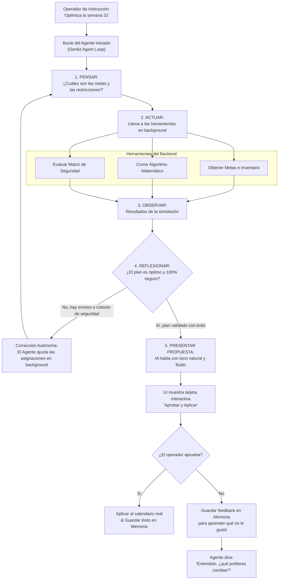

# Propuesta de Evolución: Planta Copilot 2.0 (Agente Autónomo de Razonamiento, Aprendizaje y Voz Natural)

Este documento presenta una evaluación y propuesta técnica detallada para transformar el actual **Planta Copilot** (que funciona bajo un esquema clásico de pregunta-respuesta y ejecución de comandos directos) en un **Agente Autónomo de Razonamiento Completo (Reasoning Agent)**. 

La meta es lograr un agente inteligente que actúe de manera similar a los copilotos de desarrollo de software modernos (como Devin o los asistentes de codificación avanzados): **capaz de evaluar, simular en segundo plano, aprender de tus decisiones pasadas, interactuar de manera fluida y ultra-natural (sin sonar como un robot) y resolver problemas complejos de planificación de forma 100% autónoma.**

---

## 1. Tabla Comparativa: Estado Actual vs. Planta Copilot 2.0 (Agente Autónomo)

| Característica | Planta Copilot 1.0 (Actual) | Planta Copilot 2.0 (Propuesto) |
| :--- | :--- | :--- |
| **Arquitectura de IA** | Generación simple en un solo turno (Single-Turn LLM Call). | **Bucle de Agente (Agent Loop - ReAct / Chain-of-Thought)**. |
| **Autonomía** | Ejecuta acciones estructuradas inmediatas basadas en órdenes literales. | **Planificación Multietapa autónoma**. Ejecuta simulaciones internas, evalúa múltiples combinaciones y autodetecta colisiones de seguridad antes de hablar. |
| **Aprendizaje y Memoria** | Memoria volátil de la conversación actual. Olvida lo que preferías en semanas anteriores al recargar. | **Memoria Episódica y de Preferencias (Largo Plazo)**. Almacena en Firestore tu feedback y los calendarios históricos para aprender tus patrones. |
| **Razonamiento Complejo** | Aplica reglas estáticas del prompt. | **Bucle de Pensamiento Crítico**. Auto-evalúa sus propios planes creados antes de mostrarlos, corrigiendo desviaciones. |
| **Fluidez y Conversación** | Respuestas basadas en reglas de formato del sistema. Voz TTS tradicional con latencia. | **Motor de Lenguaje Coloquial e Inteligencia Emocional** + **Integración Multimodal Directa (Gemini Live/WebRTC)** para hablar con latencia cero de forma 100% humana. |

---

## 2. Los 4 Pilares del Agente de Razonamiento Autónomo

### Pilar I: El Bucle de Razonamiento y Reflexión (Reasoning Loop / ReAct)
En lugar de pasarle toda la información al modelo en un solo prompt y esperar que devuelva una acción mágica en milisegundos, el Agente utiliza un ciclo repetitivo de **Pensamiento $\rightarrow$ Acción $\rightarrow$ Observación**:

1. **Pensamiento**: El agente analiza la meta ("Optimiza la semana 32 con el mínimo costo").
2. **Acción**: Llama a una herramienta interna (ej. *Simulador de Envasadoras* o *Verificador de Reglas de Seguridad*).
3. **Observación**: Lee el resultado de la herramienta (ej. "La Envasadora 2 superó la meta por 100 quintales, pero hay un bloqueo de seguridad con la Envasadora 3").
4. **Reflexión**: El agente razona consigo mismo: *"Vaya, mi primera idea violó la regla de combinaciones prohibidas. Debo re-programar la Envasadora 2 hacia el Producto B y volver a verificar"*.
5. **Iteración**: Repite el proceso hasta que la solución sea óptima y cumpla el 100% de las restricciones de seguridad antes de presentártela.

### Pilar II: Memoria a Corto y Largo Plazo (Continuous Learning)
Para que el Copilot no se sienta como un extraño cada vez que entras a la aplicación, implementaremos una **Base de Conocimiento Dinámica y Memoria Episódica en Firebase**:
* **Base de datos de Feedback**: Cada vez que rechazas o apruebas un plan, el agente registra en Firestore el *porqué* (ej. "Al operador no le gusta programar turnos dobles en la Envasadora 3 porque requiere mantenimiento continuo").
* **RAG de Operaciones de Planta**: Subiremos el manual de operación de la planta y los catálogos técnicos a una base de datos vectorial (Vector DB). El Copilot consultará estos documentos de forma autónoma para dar consejos de ingeniería reales.

### Pilar III: Herramientas Autónomas (Tool-Use)
Le daremos al agente acceso a una caja de herramientas de código TypeScript (Genkit Tools) que puede ejecutar de forma autónoma:
* `runLinearProgrammingOptimization()`: Un solucionador matemático en el backend que calcula la distribución perfecta de envasadoras.
* `checkSafetyMatrix()`: Valida combinaciones prohibidas y seguras instantáneamente.
* `predictSupplyBottlenecks()`: Analiza si el suministro diario de azúcar a granel alcanzará para cubrir la semana seleccionada.

### Pilar IV: Voz Fluida y Lenguaje Ultra-Natural
Para eliminar la sensación de estar hablando con un robot:
* **Integración con Gemini Multimodal Live API**: En lugar del tradicional Text-to-Speech (que primero escribe todo el texto y luego lo lee, causando una latencia de varios segundos), implementamos un canal WebRTC bidireccional. La IA te escucha en tiempo real y te responde hablando de inmediato con entonación, pausas naturales y respiración simulada.
* **Filtro de Conversación Coloquial Industrial**: El prompt del sistema se redefine con un perfil de *Ingeniero Jefe de Producción de Planta* con amplia experiencia, empático, directo y que utiliza jerga industrial natural y cercana (ej. *"Perfecto, ya veo el cuello de botella en la tolva de la Envasadora 2. Mira, te propongo lo siguiente..."*).

---

## 3. Diagrama de Flujo: El Proceso de Razonamiento del Copilot 2.0

El siguiente diagrama ilustra cómo funciona el cerebro autónomo del Copilot cuando le das una instrucción de planificación:



---

## 4. Plan de Acción y Propuesta Técnica para Control 7

Para implementar este nivel de autonomía en tu proyecto Next.js, propongo desarrollar la siguiente arquitectura utilizando las herramientas actuales del repositorio (`Genkit` + `Firebase` + `Next.js Server Actions`):

### Fase 1: Implementación del Agente de Razonamiento (Genkit Agents)
Actualmente, `copilotFlow.ts` utiliza un `generate` directo. Lo migraremos al framework de **Agents** de Genkit, definiendo herramientas explícitas con Zod schemas:

```typescript
// Ejemplo de herramienta autónoma de optimización matemática para el Agente
export const optimizePlanTool = ai.defineTool(
  {
    name: 'optimizePlanTool',
    description: 'Calcula matemáticamente la distribución óptima de máquinas semanales para cumplir las metas con el menor número de turnos.',
    inputSchema: z.object({
      weekNumber: z.number(),
      goals: z.record(z.number()),
      availableMachines: z.array(z.number())
    }),
    outputSchema: z.any(),
  },
  async (input) => {
    // Aquí corre un resolvedor Hill-Climbing o Programación Lineal en JS
    return runInternalOptimization(input);
  }
);
```

### Fase 2: Creación del Bucle de Memoria en Firestore
Crearemos una colección `/copilot_memory` en Firestore que guardará:
1. **Episodios**: `[Usuario: "No programes la máquina 3 de noche en zafra", Copilot: "Entendido, evito turnos dobles en M3 en zafra"]`
2. **Contexto de Sesión**: Un resumen condensado de los últimos 5 planes exitosos del usuario.
Al inicio de cada llamada al Copilot, una Server Action recuperará este historial y lo inyectará dinámicamente en el contexto del prompt para que el agente recuerde tus preferencias de forma constante.

### Fase 3: Integración de la API de Voz Gemini Multimodal Live (WebRTC)
Añadiremos un nuevo modo de "Copilot Live (Manos Libres)":
* En `ia-client.tsx` o un componente dedicado, abrimos una conexión WebRTC de baja latencia hacia la API de Gemini 2.5.
* Esto permite enviar audio en streaming directo (micrófono) y recibir audio de retorno (altavoz) procesado en tiempo real, logrando conversaciones fluidas, interrupciones naturales (puedes detener al Copilot a mitad de palabra y te escuchará) y entonaciones realistas no robóticas.

---

> [!NOTE]
> Esta evolución elevará el valor del software de Control 7 a un estándar de nivel empresarial mundial, convirtiendo una grilla de planificación tradicional en una **planta inteligente autogestionada**. El sistema ya cuenta con la base ideal (Next.js, Tailwind, Genkit, Firebase y Base de Datos de combinación de productos) para que esta transición sea directa y extremadamente robusta.

---

### ¿Cómo deseas proceder?
1. **Fase 1 (Agente Genkit + Herramientas Autónomas)**: ¿Te gustaría que implementemos hoy mismo el sistema de razonamiento multietapa con herramientas autónomas en `src/ai/` para que simule y analice la seguridad por sí mismo en background antes de mostrarte la tarjeta?
2. **Fase 2 (Memoria Firestore)**: ¿Deseas que prepare la estructura en la base de datos para que empiece a aprender de tus decisiones y feedback?
3. **Fase 3 (Voz Live)**: ¿Evaluamos la integración del canal de voz bidireccional y fluido?

¡Dime qué te parece esta propuesta y por dónde empezamos a construirlo!
